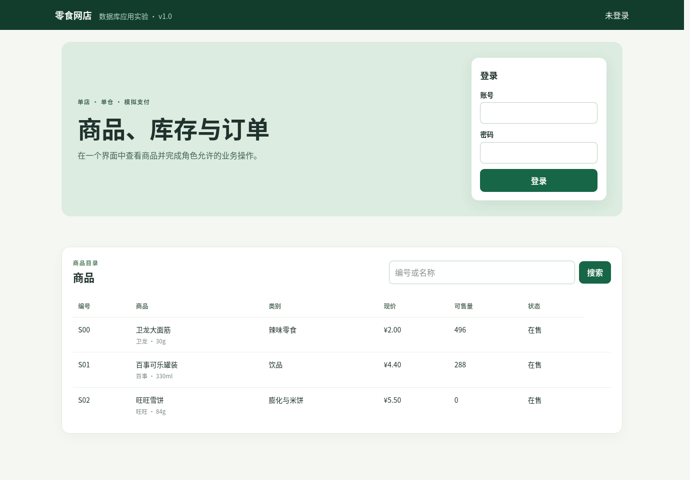
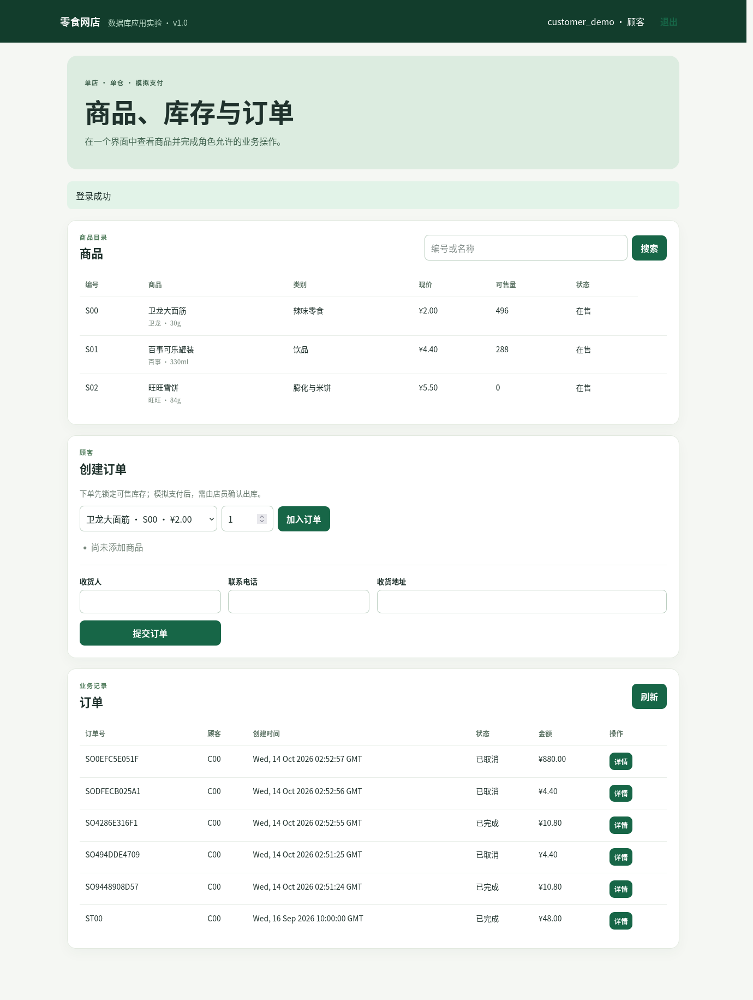
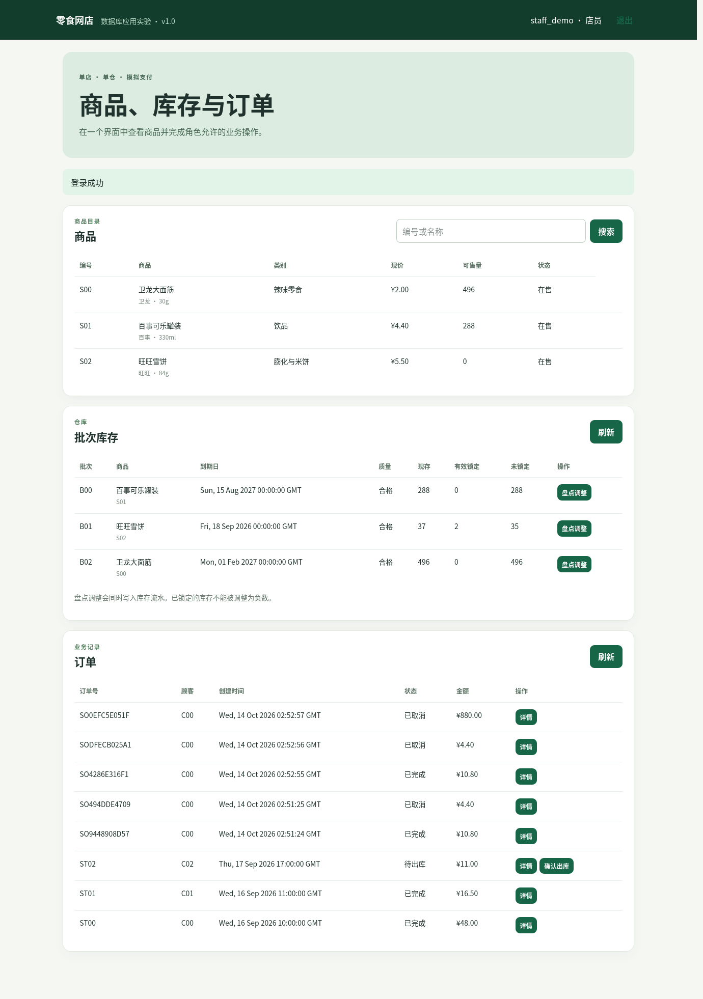
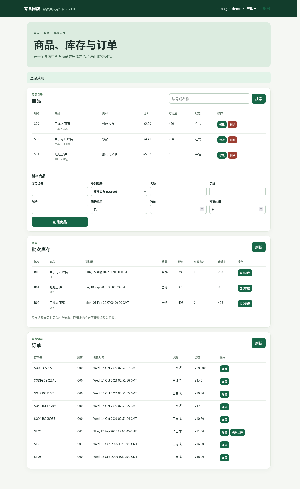
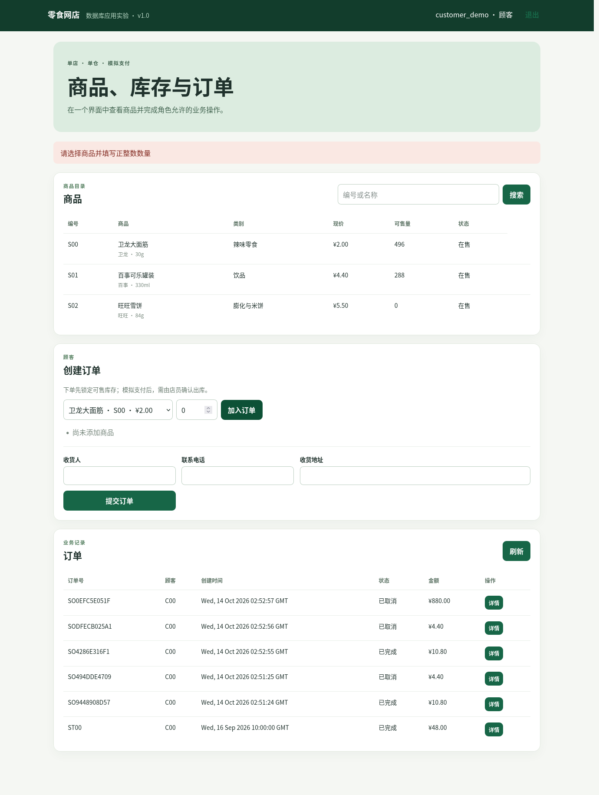

# 数据库实验第二阶段报告：规范化、迁移与 Web 应用

## 一、设计目标与业务边界

我们沿用前一阶段确定的单店、单仓零食网店。顾客浏览商品、下单并锁定批次、模拟支付；店员盘点库存并确认出库；管理员维护商品。数据库继续记录历史成交价、收货快照、支付、库存流水和会员赠分。真实支付、物流、退货及积分兑换尚不在本阶段实现范围内。这样的边界使订单状态、现存量、锁定量和积分变化都有明确的核对依据。

第六周工作从 ER 图、数据字典和 15 张表出发，检查函数依赖与更新异常，形成 v1.0 目标模式。第七至九周把该模式作为 Web 应用的数据基础。我们先写 [Week7 设计说明](Week7.md)，确定角色、分层、事务和验收案例，再实现代码和部署；详细复现步骤见[应用手册](../app/README.md)。

## 二、表结构分析与 v1.0 迁移

原来的 `InventoryMovement` 同时保存 `BatchID` 和 `PurchaseItemID`。但每个库存批次已通过 `InventoryBatch.PurchaseItemID` 指向采购明细，因此对同一流水有 `BatchID → PurchaseItemID`。两条来源链可能被改成不同值，造成一条流水对应两个采购来源。我们在 v1.0 中删除流水表重复的 `PurchaseItemID`，保留批次表的来源外码；通过批次连接仍可追溯采购明细。

迁移前，我们核对 15 表 46 行、订单金额、库存余额、积分余额及视图查询，并保存关键结果。迁移脚本在事务中改表和约束，逐行比较迁移前后库存流水的采购来源；回归脚本核对目标目录、业务查询、合法和非法写入及权限。迁移后保留的 15 张业务表不改变各自职责。目标模式有 106 个属性、23 个外键、9 项 UNIQUE。具体函数依赖、范式判断、逐表异常和 SQL 入口见 [Week6](Week6.md)、[迁移](../sql/week6/migration.sql)和[回归](../sql/week6/regression.sql)。

服务器上我们从空的独立样例库重跑第六周完整流程，得到 `W6_REGRESSION_PASS 15 46 15 64.50`：15 张业务表、46 行初始样例、已完成订单 15 件、64.50 元。该基线发生在 Web 集成测试写入数据之前；正式演示库没有执行本轮迁移。

## 三、Web 应用设计过程

### 3.1 从数据关系到四层程序

最初若把界面事件直接写成 SQL，会使页面同时负责权限、业务规则和事务边界。我们把职责拆为页面、Flask 路由、业务服务和 DAO/SQL Server：页面收集输入与展示结果；路由校验会话和 CSRF 并统一响应格式；服务层根据角色与订单状态编排操作；DAO 使用参数化 SQL 和单连接事务；数据库负责主外键、CHECK、UNIQUE 及持久化。这样一笔订单的多次写入可以统一提交或回滚，界面也不接触数据库账号。

顾客、店员、管理员分别使用不同的应用角色。数据库端另外创建三个受限登录并授予所需表或列权限，均不属于 `db_owner`。顾客的“仅本人订单”由服务层按会话绑定的 `CustomerID` 限制，不能相信页面提交的顾客编号。当前数据库登录的表级 SELECT 本身不提供行级隔离；因此 Web 服务和数据库登录都只在授权服务器内部使用，不能把数据库登录直接交给终端用户。这里如实区分应用层行级规则和数据库授权边界。

### 3.2 商品、订单与库存的规则

商品页公开在售商品及可售量，管理员可新增、修改售价和状态；有历史引用的商品保留并停售。成交明细保存下单时的单价快照，日后改商品价不会改历史订单。顾客只可改待支付订单的收货信息和明细，支付后不能再删改；取消待支付订单释放有效锁定。

下单时我们先对商品与批次做锁定读取，再检查上架状态、质量、到期日和未锁定余量，之后在一个事务中写订单、明细和预留。金额从服务器读取的现价计算，客户端金额不作为可信输入。锁定只降低可售量，不扣减 `OnHandQty`。模拟支付另成事务并拒绝第二笔成功支付；确认出库时才扣减现存、写库存流水、结束锁定、完成订单并一次赠分。店员盘点调整也同时更新批次余额和写流水，调整结果不能低于有效预留。

多商品订单有一件缺货时，整单写入回滚。两笔并发订单争用有限库存时，锁定读取和有效预留检查只允许其中一笔成功。上述设计把“界面按钮能否点”与“数据库最终能否一致”分开验证。

## 四、实现与实验过程

我们先在新样例库完成第六周复现，再安装隔离的 Python 环境、建立三个受限 SQL 登录和私有应用配置。Web 进程绑定服务器环回地址，借助授权的本地转发浏览页面。应用演示密码由部署时随机生成，公开仓库只保留代码和配置方式。服务层采用统一错误码，输入错误、未登录、越权、库存不足、约束冲突和数据库暂不可用分别返回可理解的提示；页面不显示 SQL、连接信息或异常堆栈。

我们实际运行了 [39 项 HTTP 到 SQL Server 集成检查](../result/week7/integration-20261014.txt)，包括未登录库存拒绝、顾客不能查看他人订单、CSRF 拒绝、缺货回滚、订单明细增改删、支付与重复支付、取消释放、店员出库与赠分、管理员商品维护、重复商品约束、两笔并发争抢及数据库断连提示。测试会在独立样例库中新增业务记录，因此初始 46 行的统计只用于测试前的迁移基线。

### 页面结果

未登录时能浏览商品目录，库存和订单接口由服务端拒绝匿名访问。

顾客界面提供下单与本人订单操作；待支付阶段可以修改明细，支付后操作受订单状态限制。

库存界面分开展示现存、有效锁定与可用量；到期或质量不合格的批次不能按普通可售库存处理。

管理员有商品维护入口；店员尝试相同写操作会被后端拒绝。

错误界面只给出业务提示，内部异常细节保留在私有日志。所有截图来自本轮运行页面，使用虚构样例和演示身份。

## 五、总结与待复核事项

本轮把第六周的规范化结果接到可运行的 Web 流程。我们验证了订单、库存、支付和积分在关键事务中的一致性，也把顾客、店员、管理员的页面操作与后端权限连接起来。自动集成结果为 39 项通过，部署服务仍在独立样例环境运行。

这些证据证明本轮代码与样例环境的运行结果，不等于正式库迁移或组员逐项人工验收。课程最终提交前还应由组员检查业务界面的操作顺序、课程格式、截图清晰度和本报告表述，并将人工修改与结论如实补入 AI 使用记录。
