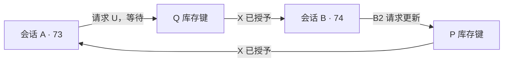

# 第13周并发实测

2026-11-25 在 SQL Server 2022 LocalDB 16.0.1000.6 的独立样例库运行。RCSI 关闭的运行中 A 为 73，B 为 74，各轮从 `READ COMMITTED` 开始。逐步日志记录实际语句步骤、会话、锁模式、等待关系、读值及单据终态。开启 RCSI 的场景在另一个独立样例库复跑。具体执行方式见[第13周说明](../../docs/week13/README.md)。

| 场景 | 锁与会话 | 实测结果 |
| --- | --- | --- |
| 写等待后 A 提交／回滚 | A 对 `Stock` 的 P 授予 KEY X，B 请求同键 X，`LCK_M_X` | 提交轮 P=13、订单完成。回滚轮 P=15、订单待完成。两轮补货单均已入库 |
| 读未提交 | B 在 A 回滚前读取 P | B 读 15，回滚后 P 为 10、补货单已批准 |
| 读已提交和锁式提示 | RCSI 关闭或使用 `READCOMMITTEDLOCK` 时，B 在 P 上等待 KEY S，`LCK_M_S` | A 回滚后 B 读 10。RCSI 开启的普通读在 A 回滚前返回已提交的 10，锁式提示仍等待 |
| 读已提交下重复读 | B 在 A 两次读之间补货并提交 | A 同事务先读 10，后读 15 |
| 可重复读 | A 保持 P 的 KEY S，B 等待 X，`LCK_M_X` | A 两次均读 10，A 提交后 B 完成，P=15 |
| 反序死锁 | A 持有 P 的 KEY X 并等待 Q 的 U，B 已持有 Q 的 KEY X，下一步请求 P | B 收到 1205，捕获时事务不可提交，清理后事务计数与状态均为 0。A 提交，P=8、Q=6，补货单仍已批准 |
| 同序访问 | B 在 P 等待 X 且未持有 Q，A 可继续锁定 Q | 无 1205，两个单据均提交，P=13、Q=11 |
| 真实订单与补货 | B 在 `DataBaseLab.WebWrite` 上等待 A，资源类型 `APPLICATION`，模式 X | A 提交时 P 的两批为 8+5=13，A 回滚时为 10+5=15，采购单均已收货。销售流水只在提交轮出现 |
| 两笔真实订单各买 6 件 | B 等待 A 的事务级应用锁，A 提交后 B 进入库存检查 | B 返回 51804 并回滚，P=4。A 完成并产生一笔 -6 出库、一笔库存审计和 30 积分，B 待出库、完成时间为空、无新预留或流水 |

死锁证据由 A2 的 DMV 快照、B2 的请求步骤和 1205 组成。库存键 `(cc9c381108b4)` 对应 P，`(277dab27e21d)` 对应 Q。步骤和实际返回见[双会话日志](sessions.json)。

- [RCSI 关闭的14项断言](checks.json)与[会话记录](sessions.json)包含每步开始和结束、两端锁状态和最终业务字段。A/B 各自核对每轮结束时的事务计数和事务状态。
- [RCSI 开启的会话记录](sessions-rcsi-on.json)保留两轮已提交读对照：普通读直接返回 10，带锁提示时等待。该次完整运行同样通过 14 项。
- [复现摘要](reproduction.txt)同时记录第10周 87 项、第11周 72 项、第12周 23 项及 103 项 Web 回归。Web 访问真实 SQL 和 Flask 路由，测试连接由 Windows ODBC 适配。

当前为本机验证，课程服务器部署与组员人工审核待确认。
